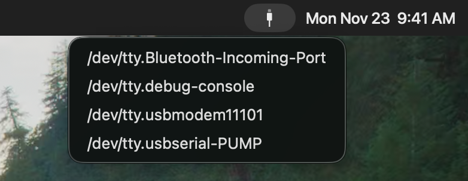

# ttybar

A tiny macOS menu bar utility for embedded developers. Click the icon, see the serial
devices in `/dev` that match your filters, click one to copy its path.

<p align="center">
  
</p>

No more `ls /dev/tty.*` before every `screen`, `picocom`, `esptool.py` or `idf.py -p`.

- Lives in the menu bar only: no Dock icon, no window.
- Rescans `/dev` every time the menu opens, so plugged and unplugged adapters show up
  immediately.
- Never opens the devices, so running sessions in other tools are not affected.
- Glob filters and a mute list to hide the noise (Bluetooth ports, debug consoles).
- No third-party dependencies, no network access, no special permissions.

## Requirements

- macOS 26 or later (Apple silicon or Intel)
- Swift 6.2 or later. The Xcode Command Line Tools are enough; Xcode is not required.

Install the Command Line Tools if you do not have them, then check the Swift version:

```sh
xcode-select --install
swift --version
```

## Install

There are no prebuilt binaries yet; ttybar is built from source. It takes a few seconds.

```sh
git clone https://github.com/yuri-saifutdinov/ttybar.git
cd ttybar
make install
```

`make install` builds a release version, ad-hoc signs it for your machine, copies it to
`/Applications/ttybar.app` and launches it. An icon appears in the menu bar. To install
somewhere else, pass the directory: `make install INSTALL_DIR=~/Applications`.

To start ttybar at login, add `/Applications/ttybar.app` under
**System Settings > General > Login Items & Extensions > Open at Login**.

## Update

From the cloned repository:

```sh
git pull
make install
```

`make install` quits the running copy, replaces the app and launches the new one. Filters and mutes are kept across updates, and the login item keeps working because the
app path does not change.

To see the installed version, right-click the icon and choose **About**, or run:

```sh
defaults read /Applications/ttybar.app/Contents/Info CFBundleShortVersionString
```

## Uninstall

1. Right-click the icon and choose **Quit** (or run `pkill -x TTYBar`).
2. Remove the login item, if you added one.
3. Delete the app and its settings:

```sh
rm -rf /Applications/ttybar.app
defaults delete dev.ttybar.TTYBar
```

## Usage

| Action | Result |
| --- | --- |
| Left click the icon | List of matching devices. Click one to copy its path; the icon shows a checkmark for a second. |
| Hold Option while the list is open | Items turn into "Mute &lt;path&gt;". Clicking one adds that exact path to the mute list. |
| Right click (or Control-click) the icon | Settings popover with Filters, Muted, About and Quit. |

A device is listed when its path matches at least one filter and no mute pattern. The
copied path has no trailing newline, so it can be pasted straight into a command:

```sh
picocom -b 115200 $(pbpaste)
```

### Filters and mutes

Both lists hold glob patterns matched against the full device path:

| Pattern | Matches |
| --- | --- |
| `*` | any run of characters except `/` |
| `?` | any single character except `/` |
| `[abc]`, `[a-z]`, `[!a]` | one character from (or not from) the set |
| `\x` | the literal character `x` |

Matching is case-sensitive, and every pattern must start with `/dev/`.

Editing in the popover:

- Type in a row and press **Return** to commit, **Escape** to revert.
- Clear a row and press Return, or click the minus button, to remove it.
- The last, empty row of each list adds a new pattern.
- Invalid patterns are marked red and not applied.

Defaults: one filter `/dev/tty.*`, no mutes. Some useful filters:

```text
/dev/tty.usbmodem*      CDC-ACM boards (most dev kits, CircuitPython, RP2040)
/dev/tty.usbserial-*    FTDI and similar USB-UART adapters
/dev/tty.SLAB_USBtoUART CP210x with the Silicon Labs driver
/dev/tty.wchusbserial*  CH34x adapters
```

Settings are stored in user defaults under `dev.ttybar.TTYBar`:

```sh
defaults read dev.ttybar.TTYBar     # show
defaults delete dev.ttybar.TTYBar   # reset to defaults (quit ttybar first)
```

## Troubleshooting

**The icon does not appear.** The menu bar may be full and macOS hides items that do not
fit, especially on notched displays. Quit a few other menu bar apps, or check that ttybar is
running with `pgrep -x TTYBar`.

**My adapter is not listed.** Check that it shows up with `ls /dev/tty.*`. If it does not,
the adapter needs a driver. If it does, make sure a filter matches its path and no mute
pattern does.

**"ttybar.app is damaged" or "cannot be opened" after copying it from another Mac.** The
app is ad-hoc signed and not notarized, so macOS blocks copies downloaded from elsewhere.
Build it on the Mac where you run it, or remove the quarantine flag:
`xattr -dr com.apple.quarantine /Applications/ttybar.app`.

## Development

```sh
make build   # debug build
make test    # unit tests (Swift Testing)
make app     # release build, assembled and ad-hoc signed as build/ttybar.app
make run     # make app, quit a running copy, launch the new one from build/
make install # make app, then install to /Applications (or INSTALL_DIR) and launch
make clean   # remove .build and build
```

`make test` adds the Swift Testing search paths automatically when only the Command Line
Tools are installed.

Layout:

- `Sources/TTYBarCore` — UI-free logic: device scanning, glob matching, pattern validation,
  settings storage. Covered by unit tests in `Tests/TTYBarCoreTests`.
- `Sources/TTYBar` — the AppKit/SwiftUI app: status item, device menu, settings popover.
- `Resources/Info.plist` — bundle metadata, including the version.
- `openspec/` — specifications and change history.

UI behavior is not covered by automated tests; run through
[docs/manual-checklist.md](docs/manual-checklist.md) after UI changes.

The version lives in two places, `Resources/Info.plist` (`CFBundleShortVersionString`) and
`Sources/TTYBarCore/Version.swift`; bump both together.

### Contributing

The project uses spec-driven development with [OpenSpec](https://github.com/Fission-AI/OpenSpec).
Current behavior is specified in `openspec/specs/`. For anything beyond a small fix, start
with a change proposal in `openspec/changes/` describing the new behavior, then implement it.
Code, comments, docs and commit messages are in English.

Issues and pull requests are welcome.

## License

[MIT](LICENSE)
